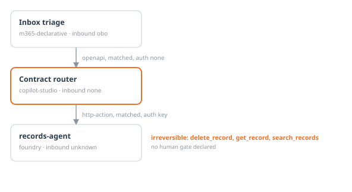

# Governance dossier: Contract router

Template: Agent Governance Dossier v1.0 · Agent Preflight 0.1.0 · 2026-09-14

> Every field is derived from the AgentBOM or a rule result. Fields that cannot be derived say *requires human input* rather than guess.

## 1. Identification

| Field | Value |
|---|---|
| Agent id | `apf_contractRouter` |
| Platform | copilot-studio |
| Name | Contract router |
| Environment | 668de38d-2e66-ec7d-b6e0-a1e20283c34e |
| Owner | *requires human input* |
| Sponsor | *requires human input* |
| Composition hash | `sha256:a4af13ab2b56943f052199ba9da0bf6093841ffe269629ba32509e0ece288342` |
| Serial | `urn:uuid:2c22b179-ec3d-5b40-a1ad-81af8e412d95` |
| Certification | uncertified |
| Collector | copilot_studio@0.2.0 |

## 2. Purpose and intended use

*requires human input*

## 3. Out of scope and prohibited uses

*requires human input* Declared residency in policy: CH.

## 4. Architecture and trust graph



*Drawn from this BOM. A dashed edge was learned by probe rather than matched, and the orange labels are irreversible actions with no human gate declared.*

**Calls**

- records-agent via `action:callRecordsAgent` (http-action), matched by endpoint, auth key, crosses platform

**Called by**

- Inbox triage (m365-declarative), matched by endpoint, auth none

## 5. Composition inventory

| Tool | Kind | Untrusted input | Irreversible | Classified by | Auth |
|---|---|---|---|---|---|
| `callRecordsAgent` (edge) | connector | yes | yes | protocol (medium) | key |

## 6. Identity and permissions

- Identity: unknown, mode unknown
- Inbound authentication: none
- Declared irreversible actions: 0
- Effective irreversible actions through delegation: 3
  - reaches `delete_record` on records-agent, not declared here
  - reaches `get_record` on records-agent, not declared here
  - reaches `search_records` on records-agent, not declared here

## 7. Data, residency and retention

- Regions observed: switzerland
- Storage and retention: *requires human input*

## 8. Attack surface analysis

- Untrusted inputs: none
- Irreversible actions: none

**CRITICAL**: web content via WebSearch reaches `delete_record`

```
web content via WebSearch  [Inbox triage, m365-declarative]
  -> POST routeEnquiry (matched, auth none)  -> [Contract router, copilot-studio]
  -> POST callRecordsAgent (matched, auth key)  -> [records-agent, foundry]
  -> delete_record  IRREVERSIBLE (MCP, destructiveHint: true)
```

**HIGH**: web content via WebSearch reaches `get_record`

```
web content via WebSearch  [Inbox triage, m365-declarative]
  -> POST routeEnquiry (matched, auth none)  -> [Contract router, copilot-studio]
  -> POST callRecordsAgent (matched, auth key)  -> [records-agent, foundry]
  -> get_record  IRREVERSIBLE (MCP, assumed: server not trusted)
```

**HIGH**: web content via WebSearch reaches `search_records`

```
web content via WebSearch  [Inbox triage, m365-declarative]
  -> POST routeEnquiry (matched, auth none)  -> [Contract router, copilot-studio]
  -> POST callRecordsAgent (matched, auth key)  -> [records-agent, foundry]
  -> search_records  IRREVERSIBLE (MCP, assumed: server not trusted)
```

## 9. Responsible AI

| Guard | Value |
|---|---|
| Content filter | unknown |
| Prompt shields | unknown |
| Human in the loop | unknown |
| Token cap | none |
| Max turns | none |

Known limitations: *requires human input*

## 10. Cost and capacity

- Per turn: 58 instruction + 0 tool-description + 0 grounding tokens
- Fan-out through delegation: x1.97
- Estimated cost per interaction: *requires human input* (no price in policy)

## 11. Findings and remediation

| Severity | Rule | Finding | Control |
|---|---|---|---|
| critical | ID-01 | Published endpoint accepts unauthenticated callers: https://668de38d2e66ec7db6e0a1e20283c3.4e.environment.api.powerplatform.com/copilotstudio/dataverse-backed/authenticated/bots/apf_contractRouter/conversations?api-version=2022-03-01-preview | ZT: agent identity and RBAC |
| critical | ID-03 | Credential for fdy-demo-agents-de-em.services.ai.azure.com is stored inline in the definition, not as a Key Vault reference. | ZT: agent identity and RBAC |
| high | ID-04 | Authenticates to fdy-demo-agents-de-em.services.ai.azure.com with a key, where the policy (policy.example.yaml) allows only managed-identity, obo. Affects 1 tool(s). | ZT: agent identity and RBAC |
| high | ID-08 | Declares 0 irreversible action(s) but can reach 3 through delegation, including records-agent/delete_record, records-agent/get_record, records-agent/search_records. None of those appear in this agent's own definition. | ZT: agent identity and RBAC |
| high | MA-08 | Calls records-agent on another platform using a key, so the callee cannot tell which agent is calling or on whose behalf. | ZT: agent identity and RBAC |

Remediation owner and dates: *requires human input*

## 12. Change log and certification

- Composition hash: `sha256:a4af13ab2b56943f052199ba9da0bf6093841ffe269629ba32509e0ece288342`
- Certification: uncertified
- Sign-off: *requires human input*

## Appendix A. Control mapping

| Rule | Control | Checks |
|---|---|---|
| AP-01 | ZT: communication governance | Untrusted input reaches an irreversible action with no human gate |
| AP-02 | ZT: communication governance | Attack path crosses a platform boundary with no human gate |
| ID-01 | ZT: agent identity and RBAC | Unauthenticated call or published endpoint |
| ID-03 | ZT: agent identity and RBAC | Secret held inline rather than as a Key Vault reference |
| ID-08 | ZT: agent identity and RBAC | Effective privilege exceeds declared privilege through delegation |
| TS-01 | ZT: communication governance | MCP endpoint attached without a tool allowlist |
| TS-06 | ZT: agent identity and RBAC | Capability granted but never referenced in the instructions |
| MA-08 | ZT: agent identity and RBAC | Cross-platform edge authenticated by key rather than a shared Entra identity |
| RA-01 | CAF: prepare environment | Content filter absent |
| RA-03 | CAF: prepare environment | Prompt shields disabled |
| RA-04 | CAF: data privacy | Grounding configured with no citation requirement |
| RA-07 | CAF: prepare environment | Declarative agent with no disclaimer |
| SC-01 | ZT: communication governance | Remote MCP tool manifest changed since it was pinned |
| SC-05 | ZT: communication governance | MCP tools fall to the fail-closed tier |
| CO-03 | CAF: track and allocate costs | No token cap and no max-turn limit |
| AP-04 | ZT: communication governance | Reachable irreversible action with no confirmation declared |
| ID-02 | ZT: agent identity and RBAC | Shared credential across agents |
| TS-04 | CAF: standardise protocols | Toolbox floating on default rather than pinned |
| TS-05 | CAF: standardise protocols | Duplicate or shadowed tool names |
| TS-08 | ZT: communication governance | Mutating operation leaves the estate with no human gate |
| MA-02 | ZT: communication governance | Recursive or cyclic delegation path |
| MA-04 | CAF: data residency | Delegation crosses a residency boundary |
| MA-07 | ZT: agent inventory and discovery | Outbound endpoint unresolvable, target unknown |
| DR-01 | CAF: data residency | Region outside the declared residency policy |
| DR-05 | ZT: memory and retrieval hygiene | Memory or vector store with no sanitisation |
| RA-05 | ZT: communication governance | No human in the loop declared for an irreversible action |
| RA-08 | CAF: prepare environment | Model knowledge left enabled on a grounded agent |
| SC-06 | ZT: communication governance | Annotations accepted from a server that is not trusted |
| CO-01 | CAF: track and allocate costs | Cost per interaction exceeds the declared budget |
| CO-06 | CAF: track and allocate costs | Instructions near the character cap and unpriced |
| CO-07 | CAF: track and allocate costs | Tool surface costs more per turn than the instructions |
| CO-09 | CAF: systematize cost optimization | No conversation history summarisation |
| AP-03 | CAF: data residency | Attack path crosses a residency or tenant boundary |
| ID-04 | ZT: agent identity and RBAC | Key authentication where the policy requires a stronger mode |
| MA-01 | ZT: communication governance | A2A endpoint attached without an allowlist |
| MA-03 | CAF: data residency | Delegation crosses a tenant boundary |
| ML-01 | CAF: govern AI models | Model deployment deprecated or retired |
| ML-03 | CAF: govern AI models | Model not on the permitted list |
| ML-05 | ZT: lifecycle management | No recertification within the policy window |
| CO-02 | CAF: track and allocate costs | Cost per interaction regressed beyond the allowed delta |
| CO-08 | CAF: track and allocate costs | No cost centre recorded for the agent |
| SC-02 | ZT: memory and retrieval hygiene | Injection payload in a tool description |
| TS-02 | ZT: agent identity and RBAC | Tool surface far beyond what the instructions reference |
| ID-07 | CAF: accountability | No accountable owner or sponsor in the registry |
| MA-05 | ZT: agent inventory and discovery | Delegation to an agent absent from the registry |

## Appendix B. Full rule results

| Rule | Result |
|---|---|
| AP-01 | pass |
| AP-02 | pass |
| ID-01 | fail (1) |
| ID-03 | fail (1) |
| ID-08 | fail (1) |
| TS-01 | pass |
| TS-06 | pass |
| MA-08 | fail (1) |
| RA-01 | pass |
| RA-03 | pass |
| RA-04 | pass |
| RA-07 | pass |
| SC-01 | pass |
| SC-05 | pass |
| CO-03 | pass |
| AP-04 | pass |
| ID-02 | pass |
| TS-04 | pass |
| TS-05 | pass |
| TS-08 | pass |
| MA-02 | pass |
| MA-04 | pass |
| MA-07 | pass |
| DR-01 | pass |
| DR-05 | pass |
| RA-05 | pass |
| RA-08 | pass |
| SC-06 | pass |
| CO-01 | pass |
| CO-06 | pass |
| CO-07 | pass |
| CO-09 | pass |
| AP-03 | pass |
| ID-04 | fail (1) |
| MA-01 | pass |
| MA-03 | pass |
| ML-01 | pass |
| ML-03 | pass |
| ML-05 | pass |
| CO-02 | pass |
| CO-08 | pass |
| SC-02 | pass |
| TS-02 | pass |
| ID-07 | pass |
| MA-05 | pass |
