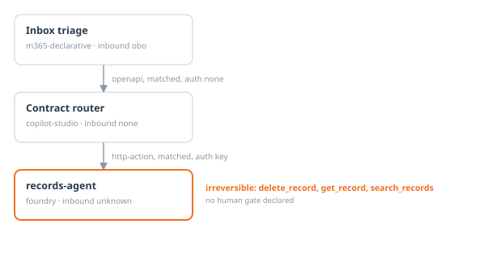

# Governance dossier: records-agent

Template: Agent Governance Dossier v1.0 · Agent Preflight 0.1.0 · 2026-09-14

> Every field is derived from the AgentBOM or a rule result. Fields that cannot be derived say *requires human input* rather than guess.

## 1. Identification

| Field | Value |
|---|---|
| Agent id | `asst_Y3XUjyknLU4ZzR732qhPDe7F` |
| Platform | foundry |
| Name | records-agent |
| Environment | https://fdy-demo-agents-de-em.services.ai.azure.com/api/projects/preflight |
| Owner | *requires human input* |
| Sponsor | *requires human input* |
| Composition hash | `sha256:49270ea762ce762cc0a8cf82a94a4c9f6459c2b0f368fc4a59d6e5e9e605ac5d` |
| Serial | `urn:uuid:77afde95-3c67-5d29-a299-047945aa7cbd` |
| Certification | uncertified |
| Collector | foundry@0.1.0 |

## 2. Purpose and intended use

*requires human input*

## 3. Out of scope and prohibited uses

*requires human input* Declared residency in policy: CH.

## 4. Architecture and trust graph



*Drawn from this BOM. A dashed edge was learned by probe rather than matched, and the orange labels are irreversible actions with no human gate declared.*

**Calls**

- none in the scanned estate

**Called by**

- Contract router (copilot-studio), matched by endpoint, auth key

## 5. Composition inventory

| Tool | Kind | Untrusted input | Irreversible | Classified by | Auth |
|---|---|---|---|---|---|
| `get_record` | mcp | yes | yes | failclosed (low) | key |
| `search_records` | mcp | yes | yes | failclosed (low) | key |
| `delete_record` | mcp | yes | yes | protocol (high) | key |

| Model deployment | Region | Status |
|---|---|---|
| `gpt-5-mini-global` | switzerlandnorth | unknown |

## 6. Identity and permissions

- Identity: unknown, mode unknown
- Inbound authentication: unknown
- Declared irreversible actions: 3
- Effective irreversible actions through delegation: 3

## 7. Data, residency and retention

- Regions observed: switzerlandnorth
- Storage and retention: *requires human input*

## 8. Attack surface analysis

- Untrusted inputs: get_record, search_records, delete_record
- Irreversible actions: get_record, search_records, delete_record

**CRITICAL**: web content via WebSearch reaches `delete_record`

```
web content via WebSearch  [Inbox triage, m365-declarative]
  -> POST routeEnquiry (matched, auth none)  -> [Contract router, copilot-studio]
  -> POST callRecordsAgent (matched, auth key)  -> [records-agent, foundry]
  -> delete_record  IRREVERSIBLE (MCP, destructiveHint: true)
```

**HIGH**: web content via WebSearch reaches `get_record`

```
web content via WebSearch  [Inbox triage, m365-declarative]
  -> POST routeEnquiry (matched, auth none)  -> [Contract router, copilot-studio]
  -> POST callRecordsAgent (matched, auth key)  -> [records-agent, foundry]
  -> get_record  IRREVERSIBLE (MCP, assumed: server not trusted)
```

**HIGH**: web content via WebSearch reaches `search_records`

```
web content via WebSearch  [Inbox triage, m365-declarative]
  -> POST routeEnquiry (matched, auth none)  -> [Contract router, copilot-studio]
  -> POST callRecordsAgent (matched, auth key)  -> [records-agent, foundry]
  -> search_records  IRREVERSIBLE (MCP, assumed: server not trusted)
```

## 9. Responsible AI

| Guard | Value |
|---|---|
| Content filter | none |
| Prompt shields | no |
| Human in the loop | no |
| Token cap | none |
| Max turns | none |

Known limitations: *requires human input*

## 10. Cost and capacity

- Per turn: 31 instruction + 25 tool-description + 0 grounding tokens
- Fan-out through delegation: x1.0
- Estimated cost per interaction: *requires human input* (no price in policy)

## 11. Findings and remediation

| Severity | Rule | Finding | Control |
|---|---|---|---|
| critical | AP-02 | web content via WebSearch reaches `delete_record` (MCP, destructiveHint: true) across 3 platforms, with no human gate anywhere on the path. 5 source(s) reach this sink. | ZT: communication governance |
| critical | ID-03 | Credential for mcp.records.contoso-internal.example is stored inline in the definition, not as a Key Vault reference. | ZT: agent identity and RBAC |
| critical | RA-01 | No content filter is configured. | CAF: prepare environment |
| critical | RA-03 | Prompt shields are disabled, so jailbreak and indirect injection attempts are not screened. | CAF: prepare environment |
| high | AP-02 | Possible path: web content via WebSearch reaches `get_record` (MCP, assumed: server not trusted) across 3 platforms, with no human gate anywhere on the path. 5 source(s) reach this sink. Reported one level lower because the sink's irreversibility is assumed, not declared. | ZT: communication governance |
| high | AP-02 | Possible path: web content via WebSearch reaches `search_records` (MCP, assumed: server not trusted) across 3 platforms, with no human gate anywhere on the path. 5 source(s) reach this sink. Reported one level lower because the sink's irreversibility is assumed, not declared. | ZT: communication governance |
| high | CO-03 | No token cap and no max-turn limit, so a runaway loop has no ceiling. | CAF: track and allocate costs |
| high | ID-04 | Authenticates to mcp.records.contoso-internal.example with a key, where the policy (policy.example.yaml) allows only managed-identity, obo. Affects 3 tool(s). | ZT: agent identity and RBAC |
| high | RA-05 | Human in the loop is switched off while 3 irreversible action(s) are attached: delete_record, get_record, search_records. | ZT: communication governance |
| high | TS-01 | MCP server mcp.records.contoso-internal.example is attached with no tool allowlist, exposing all 3 of its tools: delete_record, get_record, search_records. | ZT: communication governance |
| medium | SC-05 | 2 tool(s) from mcp.records.contoso-internal.example fall back to the worst case because they come from a server that is not on the trusted list, so their read-only claims cannot be relied on: get_record, search_records. | ZT: communication governance |
| medium | SC-06 | The classification of delete_record rests on annotations from mcp.records.contoso-internal.example, which is not on the trusted list. They were accepted only because they make the classification worse. | ZT: communication governance |

Remediation owner and dates: *requires human input*

## 12. Change log and certification

- Composition hash: `sha256:49270ea762ce762cc0a8cf82a94a4c9f6459c2b0f368fc4a59d6e5e9e605ac5d`
- Certification: uncertified
- Sign-off: *requires human input*

## Appendix A. Control mapping

| Rule | Control | Checks |
|---|---|---|
| AP-01 | ZT: communication governance | Untrusted input reaches an irreversible action with no human gate |
| AP-02 | ZT: communication governance | Attack path crosses a platform boundary with no human gate |
| ID-01 | ZT: agent identity and RBAC | Unauthenticated call or published endpoint |
| ID-03 | ZT: agent identity and RBAC | Secret held inline rather than as a Key Vault reference |
| ID-08 | ZT: agent identity and RBAC | Effective privilege exceeds declared privilege through delegation |
| TS-01 | ZT: communication governance | MCP endpoint attached without a tool allowlist |
| TS-06 | ZT: agent identity and RBAC | Capability granted but never referenced in the instructions |
| MA-08 | ZT: agent identity and RBAC | Cross-platform edge authenticated by key rather than a shared Entra identity |
| RA-01 | CAF: prepare environment | Content filter absent |
| RA-03 | CAF: prepare environment | Prompt shields disabled |
| RA-04 | CAF: data privacy | Grounding configured with no citation requirement |
| RA-07 | CAF: prepare environment | Declarative agent with no disclaimer |
| SC-01 | ZT: communication governance | Remote MCP tool manifest changed since it was pinned |
| SC-05 | ZT: communication governance | MCP tools fall to the fail-closed tier |
| CO-03 | CAF: track and allocate costs | No token cap and no max-turn limit |
| AP-04 | ZT: communication governance | Reachable irreversible action with no confirmation declared |
| ID-02 | ZT: agent identity and RBAC | Shared credential across agents |
| TS-04 | CAF: standardise protocols | Toolbox floating on default rather than pinned |
| TS-05 | CAF: standardise protocols | Duplicate or shadowed tool names |
| TS-08 | ZT: communication governance | Mutating operation leaves the estate with no human gate |
| MA-02 | ZT: communication governance | Recursive or cyclic delegation path |
| MA-04 | CAF: data residency | Delegation crosses a residency boundary |
| MA-07 | ZT: agent inventory and discovery | Outbound endpoint unresolvable, target unknown |
| DR-01 | CAF: data residency | Region outside the declared residency policy |
| DR-05 | ZT: memory and retrieval hygiene | Memory or vector store with no sanitisation |
| RA-05 | ZT: communication governance | No human in the loop declared for an irreversible action |
| RA-08 | CAF: prepare environment | Model knowledge left enabled on a grounded agent |
| SC-06 | ZT: communication governance | Annotations accepted from a server that is not trusted |
| CO-01 | CAF: track and allocate costs | Cost per interaction exceeds the declared budget |
| CO-06 | CAF: track and allocate costs | Instructions near the character cap and unpriced |
| CO-07 | CAF: track and allocate costs | Tool surface costs more per turn than the instructions |
| CO-09 | CAF: systematize cost optimization | No conversation history summarisation |
| AP-03 | CAF: data residency | Attack path crosses a residency or tenant boundary |
| ID-04 | ZT: agent identity and RBAC | Key authentication where the policy requires a stronger mode |
| MA-01 | ZT: communication governance | A2A endpoint attached without an allowlist |
| MA-03 | CAF: data residency | Delegation crosses a tenant boundary |
| ML-01 | CAF: govern AI models | Model deployment deprecated or retired |
| ML-03 | CAF: govern AI models | Model not on the permitted list |
| ML-05 | ZT: lifecycle management | No recertification within the policy window |
| CO-02 | CAF: track and allocate costs | Cost per interaction regressed beyond the allowed delta |
| CO-08 | CAF: track and allocate costs | No cost centre recorded for the agent |
| SC-02 | ZT: memory and retrieval hygiene | Injection payload in a tool description |
| TS-02 | ZT: agent identity and RBAC | Tool surface far beyond what the instructions reference |
| ID-07 | CAF: accountability | No accountable owner or sponsor in the registry |
| MA-05 | ZT: agent inventory and discovery | Delegation to an agent absent from the registry |

## Appendix B. Full rule results

| Rule | Result |
|---|---|
| AP-01 | pass |
| AP-02 | fail (3) |
| ID-01 | pass |
| ID-03 | fail (1) |
| ID-08 | pass |
| TS-01 | fail (1) |
| TS-06 | pass |
| MA-08 | pass |
| RA-01 | fail (1) |
| RA-03 | fail (1) |
| RA-04 | pass |
| RA-07 | pass |
| SC-01 | pass |
| SC-05 | fail (1) |
| CO-03 | fail (1) |
| AP-04 | pass |
| ID-02 | pass |
| TS-04 | pass |
| TS-05 | pass |
| TS-08 | pass |
| MA-02 | pass |
| MA-04 | pass |
| MA-07 | pass |
| DR-01 | pass |
| DR-05 | pass |
| RA-05 | fail (1) |
| RA-08 | pass |
| SC-06 | fail (1) |
| CO-01 | pass |
| CO-06 | pass |
| CO-07 | pass |
| CO-09 | pass |
| AP-03 | pass |
| ID-04 | fail (1) |
| MA-01 | pass |
| MA-03 | pass |
| ML-01 | pass |
| ML-03 | pass |
| ML-05 | pass |
| CO-02 | pass |
| CO-08 | pass |
| SC-02 | pass |
| TS-02 | pass |
| ID-07 | pass |
| MA-05 | pass |
